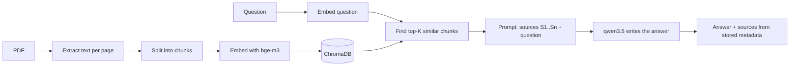

# DocuMind AI - Zero-Budget Local RAG Chatbot

Ask questions about your own PDFs and get answers with the source file and
page number, using only software that runs on your computer. No paid API, no
API key, no cloud.

- **Local LLM and embeddings** through [Ollama](https://ollama.com)
  (`qwen3.5:4b` for answers, `bge-m3` for embeddings)
- **Local vector database** with ChromaDB, stored on disk
- **PDF text extraction** with PyMuPDF
- **Simple web UI** with Streamlit
- **No LangChain / LlamaIndex**: the whole RAG pipeline is a few hundred lines
  of readable Python

> Built and tested on Windows 11 with Python 3.11.

## Contents

1. [What it does](#what-it-does)
2. [How it works](#how-it-works)
3. [Requirements](#requirements)
4. [Installation (Windows 11)](#installation-windows-11)
5. [Running the app](#running-the-app)
6. [Using the app](#using-the-app)
7. [Configuration](#configuration)
8. [Running the tests](#running-the-tests)
9. [Checking the real pipeline](#checking-the-real-pipeline)
10. [Checking GPU use](#checking-gpu-use)
11. [Evaluation](#evaluation)
12. [Troubleshooting](#troubleshooting)
13. [Limitations](#limitations)
14. [Screenshots](#screenshots)
15. [Future improvements](#future-improvements)
16. [Project structure](#project-structure)

## What it does

- Upload one or more text-based PDFs and index them locally.
- Ask a question in a chat interface.
- Get an answer written only from the indexed documents, with citations such
  as `[S1]` that map to a real filename and page number.
- If the documents do not contain the answer, the assistant says so instead
  of guessing.
- The index is saved on disk, so it is still there after a restart.
- Delete documents from the index at any time.

## How it works



The source list under each answer is built from data stored in the database,
never from text written by the model. See
[docs/architecture.md](docs/architecture.md) for the design decisions.

## Requirements

| Item | Requirement |
| --- | --- |
| Operating system | Windows 11 |
| Python | 3.11 |
| RAM | 16 GB recommended |
| Disk | About 5 GB for the two models, plus about 1 GB for Python packages |
| GPU | Optional. An NVIDIA GPU makes answers much faster. Without one, Ollama runs on the CPU |
| Internet | Only for installation and downloading the models. Not needed to use the app |

Model download sizes: `bge-m3` 1.2 GB, `qwen3.5:4b` 3.3 GB.

## Installation (Windows 11)

Run these commands in **PowerShell**.

### 1. Install Ollama

Download the installer from <https://ollama.com/download> and run it, or use
winget:

```powershell
winget install Ollama.Ollama
```

Ollama then runs in the background (look for its icon in the system tray).
Check it:

```powershell
ollama --version
```

### 2. Download the two models

```powershell
ollama pull bge-m3
```

```powershell
ollama pull qwen3.5:4b
```

**Lower-memory fallback:** if answers are very slow or Ollama reports that it
is out of memory, use the smaller chat model instead and set
`CHAT_MODEL=qwen3.5:2b` in `.env` (step 6):

```powershell
ollama pull qwen3.5:2b
```

Larger models (for example a 9B model) are not recommended unless you have
checked that your GPU has enough VRAM for them.

Confirm what is installed:

```powershell
ollama list
```

### 3. Get the project

Open PowerShell in the project folder (the folder that contains `app.py`).

### 4. Create a Python 3.11 environment

Use **one** of the two options.

**Option A - venv** (if Python 3.11 is installed from
[python.org](https://www.python.org/downloads/)):

```powershell
py -3.11 -m venv .venv
```

```powershell
.\.venv\Scripts\Activate.ps1
```

**Option B - conda** (if you use Anaconda or Miniconda):

```powershell
conda create -n documind-ai python=3.11 -y
```

```powershell
conda activate documind-ai
```

Check the version; it should print `Python 3.11.x`:

```powershell
python --version
```

### 5. Install the Python packages

```powershell
python -m pip install -r requirements.txt
```

### 6. Create your `.env` file

```powershell
Copy-Item .env.example .env
```

The defaults work as they are. `.env` is git-ignored. No secrets are needed.

## Running the app

Make sure Ollama is running and your environment is activated, then:

```powershell
streamlit run app.py
```

Open <http://localhost:8501> in your browser. (The browser is not opened
automatically.) Press `Ctrl + C` in PowerShell to stop the app.

## Using the app

1. **Check the status** at the top of the sidebar. Ollama and both models
   should show as running / ready.
2. **Upload PDFs** under *Add documents* and click **Index documents**. A
   progress bar shows each file being read, embedded and saved.
3. **Ask a question** in the box at the bottom of the page.
4. **Open the Sources panel** under an answer to read the exact passages the
   model was given, with filename and page. Sources the answer cites are
   marked.
5. **Delete** a document with the button under its name in the sidebar.
6. **Clear chat** removes the conversation from the screen. It does not touch
   the index.

Good to know:

- Uploading the same file twice does not create duplicates; it is skipped.
- A file with the same name but different content is stored as a separate
  document (the short ID under the filename tells them apart).
- If the answer is not in your documents, the reply is: *"I could not find
  this information in the indexed documents."*
- The first question after starting Ollama is slower, because the model has
  to be loaded into memory.

## Configuration

All settings live in `.env`. Restart the app after changing them.

| Setting | Default | Meaning |
| --- | --- | --- |
| `OLLAMA_BASE_URL` | `http://localhost:11434` | Address of the local Ollama service |
| `CHAT_MODEL` | `qwen3.5:4b` | Model that writes answers. Fallback: `qwen3.5:2b` |
| `EMBEDDING_MODEL` | `bge-m3` | Model that turns text into vectors |
| `CHROMA_PATH` | `data/chroma` | Folder where the index is stored |
| `COLLECTION_NAME` | `documind_local` | Name of the ChromaDB collection |
| `CHUNK_SIZE` | `1200` | Maximum characters per chunk |
| `CHUNK_OVERLAP` | `200` | Characters shared between neighbouring chunks |
| `TOP_K` | `5` | Number of chunks retrieved per question |
| `NUM_CTX` | `4096` | Context window (tokens) given to the chat model |
| `MAX_PDF_SIZE_MB` | `25` | Largest PDF that can be uploaded |

Notes:

- **Changing `EMBEDDING_MODEL`** requires a new `COLLECTION_NAME` (or deleting
  the `data/chroma` folder) and re-indexing. Vectors from different models
  cannot be mixed, and the app refuses to start if they would be.
- **Changing `CHUNK_SIZE` / `CHUNK_OVERLAP`** only affects documents indexed
  afterwards. Upload a document again to re-index it with the new settings.
- The embedding vector size is not configured anywhere; it is taken from what
  the model returns.

## Running the tests

```powershell
python -m pytest
```

The tests do not need Ollama, the models, the internet or any private
document: Ollama is replaced by a fake, and PDFs are generated on the fly.

They cover chunking, PDF extraction, stable chunk IDs, duplicate ingestion,
deletion, retrieval, prompt construction, source integrity, abstention, error
handling and a headless smoke test of the Streamlit UI.

## Checking the real pipeline

This script uses the real Ollama service and the real embedding model (the
chat model is not needed). It indexes a small generated PDF into a temporary
folder, runs a search, and confirms that re-indexing does not create
duplicates. Your real index is not touched.

```powershell
python scripts\verify_retrieval.py
```

With your own PDF and question:

```powershell
python scripts\verify_retrieval.py "C:\path\to\file.pdf" "Your question?"
```

Expected final line: `All checks passed.`

## Checking GPU use

The app works with or without a GPU, and Ollama decides by itself how to
split a model between GPU and CPU.

See your GPU and its memory:

```powershell
nvidia-smi
```

Ask a question in the app, then within a few minutes run:

```powershell
ollama ps
```

Read the `PROCESSOR` column:

| Value | Meaning |
| --- | --- |
| `100% GPU` | The model is fully on the GPU (fastest) |
| `45%/55% CPU/GPU` (example) | The model is split because it does not fit in VRAM. It works, but slower |
| `100% CPU` | No GPU is being used |

If the chat model is split or on the CPU and answers are too slow, switch to
`qwen3.5:2b` (see [Installation](#2-download-the-two-models)) or close other
programs that use the GPU.

On the machine this project was developed on (NVIDIA GeForce RTX 5060 Ti,
8 GB VRAM, Ollama 0.40.16), `ollama ps` showed both `qwen3.5:4b` and `bge-m3`
at `100% GPU`. Your result depends on your GPU and drivers, so check it
yourself with the commands above.

## Evaluation

No evaluation results are published with this project. The `evaluation`
folder contains a CSV template for 30-50 manually labelled questions and a
script that measures Recall@K and abstention automatically, leaving answer
correctness and citation correctness for manual review. See
[evaluation/README.md](evaluation/README.md).

## Troubleshooting

| Problem | What to do |
| --- | --- |
| Sidebar shows **Ollama: not reachable** | Start the Ollama app from the Start menu (or run `ollama serve`), then click **Check again**. Confirm `OLLAMA_BASE_URL` in `.env` |
| **Model ... is not installed** | Run the `ollama pull ...` command shown in the message |
| `ollama` is not recognised in PowerShell | Close and reopen PowerShell after installing Ollama |
| `Activate.ps1 cannot be loaded because running scripts is disabled` | Skip activation and call the environment's Python directly: `.\.venv\Scripts\python.exe -m streamlit run app.py` |
| `py` is not recognised | Use Option B (conda), or install Python 3.11 from python.org with the "py launcher" option ticked |
| `streamlit` is not recognised | The environment is not activated. Activate it, or run `python -m streamlit run app.py` |
| **... has no extractable text** | The PDF is a scan or image-only. Run it through OCR first, then upload the result |
| **... is password protected** | Remove the password in a PDF reader and upload it again |
| **... is over the 25 MB limit** | Raise `MAX_PDF_SIZE_MB` in `.env` and restart, or split the PDF |
| **The collection ... was built with the embedding model ...** | You changed `EMBEDDING_MODEL`. Set a new `COLLECTION_NAME` in `.env`, or delete `data\chroma`, then re-index |
| Answers are very slow | Check `ollama ps`. If the model is on the CPU or split, try `CHAT_MODEL=qwen3.5:2b` |
| Out-of-memory error from Ollama | Use `qwen3.5:2b`, lower `NUM_CTX` (for example `2048`), or close other GPU programs |
| Answer says the information could not be found, but it is in the PDF | Open the Sources panel to see what was retrieved. Try rewording the question or raising `TOP_K` |
| Port 8501 is already in use | `streamlit run app.py --server.port 8502` |
| "Something unexpected went wrong" | Details are in `logs\documind.log` |
| Start again with an empty index | Stop the app and delete the `data\chroma` folder |

## Limitations

- **Text-based PDFs only.** Scanned or image-only PDFs are rejected; there is
  no OCR.
- **Tables, columns and figures** are read as plain text, so complex layouts
  may be extracted in a confusing order. Images are ignored.
- **Each question is answered on its own.** The chat history is shown on
  screen but is not sent to the model, so follow-ups such as "and what about
  the second one?" need to be asked as complete questions.
- **A small local model makes mistakes.** It can misread a passage, cite the
  wrong one of the retrieved sources, or abstain when the answer was
  retrieved. Citations always point to passages that really were retrieved,
  but check important answers against the source text.
- **Prompt injection is reduced, not eliminated.** PDF text is treated as
  untrusted reference material, but a small model can still be influenced by
  instructions hidden in a document.
- **Chunks do not cross pages**, so a sentence that continues onto the next
  page is split between two chunks.
- **Semantic search only.** There is no keyword search or re-ranking, so exact
  codes or rare names may be missed.
- **Quality has not been measured.** No evaluation has been run yet.
- **Single user, local use.** There is no login, and the app listens on
  `localhost` only.
- **Chat history is not saved** between browser sessions. The document index is.

## Screenshots

Placeholders. Add your own images to `docs/screenshots/` (see
[docs/screenshots/README.md](docs/screenshots/README.md)) and they will
appear here.

| Screen | Image |
| --- | --- |
| Empty state | `docs/screenshots/01-empty-state.png` *(to be added)* |
| Indexed documents | `docs/screenshots/02-indexed-documents.png` *(to be added)* |
| Answer with sources | `docs/screenshots/03-answer-with-sources.png` *(to be added)* |
| Abstention | `docs/screenshots/04-abstention.png` *(to be added)* |

## Future improvements

- Run the evaluation on a labelled question set and publish the results.
- Hybrid search (keyword + vector) and a re-ranking step.
- Use recent chat turns to rewrite follow-up questions before retrieval.
- OCR for scanned PDFs.
- Better handling of tables and multi-column layouts.
- Filter questions to selected documents.
- Support other formats (Word, Markdown, plain text).
- A tuned similarity cut-off, once evaluation shows a value that helps.

## Project structure

```text
documind-ai/
├── app.py                      Streamlit UI (no business logic)
├── requirements.txt
├── .env.example                Copy to .env
├── .streamlit/config.toml      Streamlit settings (telemetry off, localhost only)
├── src/
│   ├── config.py               Settings from .env, validated in one place
│   ├── errors.py               User-facing error types
│   ├── pdf_loader.py           PDF validation + page-by-page text extraction
│   ├── chunking.py             Page-aware chunking + stable chunk IDs
│   ├── ollama_client.py        Embeddings and chat through local Ollama
│   ├── vector_store.py         ChromaDB: upsert, search, list, delete
│   ├── ingestion.py            PDF -> chunks -> vectors -> database
│   ├── retrieval.py            Question -> top-K chunks
│   ├── rag.py                  Prompt, citations, abstention
│   └── document_service.py     Facade used by the UI
├── scripts/
│   └── verify_retrieval.py     Manual check against the real Ollama service
├── evaluation/
│   ├── README.md               Metrics explained
│   ├── eval_questions_template.csv
│   └── run_evaluation.py
├── docs/
│   ├── architecture.md
│   └── screenshots/
├── tests/                      pytest suite (Ollama is faked)
└── data/chroma/                Local index (created on first run, git-ignored)
```

## Privacy

- Documents, vectors, questions and answers stay on your computer.
- The app's own code only connects to the local Ollama service.
- ChromaDB telemetry and Streamlit usage statistics are switched off.
- `.env`, `data/chroma`, logs and evaluation results are git-ignored.
