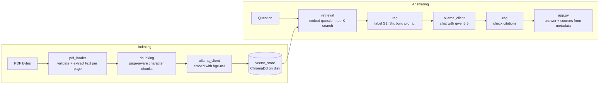

# DocuMind AI - Architecture

This document explains how the application works and why it was built this
way. It is written so the whole pipeline can be explained in a few minutes.

## The two pipelines

**Indexing** (`src/ingestion.py`): PDF -> text per page -> chunks -> vectors ->
ChromaDB.

**Answering** (`src/rag.py`): question -> vector -> nearest chunks -> prompt ->
local model -> checked answer with sources.

## Modules

| Module | Responsibility |
| --- | --- |
| `app.py` | Streamlit screen only. Calls `DocumentService`, contains no business logic |
| `src/config.py` | Reads and validates every setting from `.env` in one place |
| `src/errors.py` | User-facing exception types; their messages are shown in the UI as-is |
| `src/pdf_loader.py` | Validates a PDF and extracts text page by page (PyMuPDF) |
| `src/chunking.py` | Splits page text into overlapping chunks; builds stable chunk IDs |
| `src/ollama_client.py` | The only code that talks to Ollama: embeddings and chat |
| `src/vector_store.py` | The only code that talks to ChromaDB: upsert, search, list, delete |
| `src/ingestion.py` | Indexing pipeline; makes re-indexing idempotent |
| `src/retrieval.py` | Embeds the question and returns the top-K chunks |
| `src/rag.py` | Prompt, context budget, citation checks, abstention |
| `src/document_service.py` | Facade used by the UI; wires the pieces together |

Dependencies point one way (`app -> document_service -> rag/ingestion ->
retrieval/chunking/pdf_loader -> ollama_client/vector_store -> config/errors`),
so there are no circular imports.

## Key design decisions

### No LangChain or LlamaIndex

The pipeline is a handful of direct calls to Ollama and ChromaDB. Every step
is visible in this repository, which makes it easier to debug, test and
explain than a framework abstraction.

### Page-aware chunks

A chunk never crosses a page boundary. A sentence that continues onto the next
page is split, which costs a little context, but every chunk has exactly one
page number, so a citation is always exact.

### Character-based chunking

Chunk size and overlap are measured in characters (default 1200 / 200). No
tokenizer download is needed and the result is fully deterministic. Cuts
prefer whitespace so words are not split. Forward progress is guaranteed
because a whitespace cut is only accepted if the next chunk still starts
later than the current one; otherwise a hard cut is used.

### File identity = SHA-256 of the bytes

- Chunk ID = `<file hash>:p<page>:c<chunk index>`.
- Same bytes -> same IDs -> ChromaDB `upsert` overwrites instead of duplicating.
- Same filename with different bytes -> different hash -> a separate document.
- Uploading an unchanged file again is detected and skipped without
  re-embedding. If the chunk settings changed, the document is re-embedded and
  its old chunks are removed only after the new embeddings succeeded.

### One embedding model per collection

The collection stores the name of the embedding model that built it. Opening
it with a different `EMBEDDING_MODEL` raises a clear error instead of silently
mixing incompatible vectors. The vector size is never hardcoded: ChromaDB
takes it from the first vectors it receives.

### Cosine distance, no threshold

Retrieval returns the top-K chunks ranked by cosine distance. The distance is
shown as a ranking signal and is never called a confidence score. No
similarity cut-off is applied, because any value would be a guess until it is
tuned on the evaluation set (see `evaluation/README.md`).

### Grounding and citations

- The system prompt tells the model to answer only from the supplied sources,
  to reply with a fixed sentence when the answer is missing, and to cite
  sources as `[S1]`, `[S2]`.
- Labels are assigned by code, in retrieval order, before the model runs.
- The source list in the UI is built from the retrieved chunks' stored
  metadata. Text written by the model cannot add a source or change a
  filename or page number.
- Citation labels in the answer that do not match a retrieved source are
  removed before display.
- If nothing was retrieved, the model is not called at all.

What this does **not** guarantee: the model can still misread a source or
cite the wrong one of the retrieved sources. That is what the evaluation's
answer-correctness and citation-correctness checks are for.

### PDF text is untrusted

Text from a PDF is placed in the user message inside `<source>` tags, never
in the system message. The system prompt states that sources are reference
material, not instructions. Tag-like text inside a PDF is neutralised so a
document cannot close the source block or fake another source. This reduces
the risk of prompt injection; with a small local model it cannot remove it.

### Context budget

Ollama silently cuts off the start of a prompt that is longer than `NUM_CTX`,
which could remove the system rules. To avoid that, the app estimates the
prompt size pessimistically, reserves a quarter of the window (at most 1024
tokens) for the answer, and drops the lowest-ranked sources if they do not
fit. The UI shows exactly the sources that were sent.

### Thinking mode is off

Qwen3.5 can "think" before answering. The hidden reasoning uses up the small
context window and makes answers much slower, so the app requests answers with
thinking disabled (and retries without the flag for models that do not have
such a mode).

### Local only, no telemetry

- App logic only calls `OLLAMA_BASE_URL` (localhost by default).
- ChromaDB's anonymous telemetry is disabled in `src/vector_store.py`.
- Streamlit's usage statistics are disabled in `.streamlit/config.toml`, and
  the server listens on `localhost` only.
- ChromaDB is always given ready-made vectors, so it never downloads its own
  default embedding model.

## Testing approach

- Ollama is replaced by `FakeOllamaClient` (`tests/conftest.py`), which returns
  deterministic bag-of-words vectors, so retrieval tests are meaningful
  without any model.
- ChromaDB is real, running against a temporary folder.
- PDFs are generated synthetically with PyMuPDF, including encrypted,
  image-only and corrupted ones.
- `tests/test_app.py` runs the Streamlit script headlessly with Streamlit's
  `AppTest` runner.
- `scripts/verify_retrieval.py` is the one check that uses the real Ollama
  service; it is run by hand.
